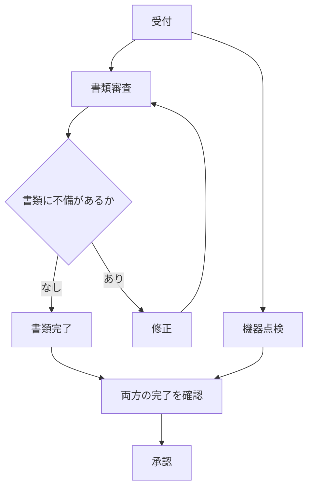

# 適用例

数値・条件は説明用の仮定。未知の情報を補わず、問いに必要な形だけを作る。

## 正確な比較を先に行う

入力: 「端末Aは12万円・1.1kg・電池8時間、Bは10万円・1.4kg・12時間、Cは9万円・1.2kg・電池未測定。10時間以上が必須。候補を整理して」

| 候補 | 価格 | 重量 | 電池 | 必須条件の判定 |
|---|---:|---:|---|---|
| A | 12万円 | 1.1kg | 8時間 | 不適合 |
| B | 10万円 | 1.4kg | 12時間 | 適合 |
| C | 9万円 | 1.2kg | 未測定 | 判定保留 |

提示値ではBが条件を満たす。Cは測定後に比較する。価格と重量だけの二軸図へ縮約しない。実際の購入判断であれば測定条件も揃える。

## 並行工程と合流条件を保つ

入力: 「受付後、書類審査と機器点検を別々に進め、両方完了したら承認する。不備は修正後に再審査する。所要時間は不明」

矢印は手順と開始条件を示す。「両方の完了」を条件として保持し、日時や長さに所要時間の意味を与えない。

## 仮説の循環を示す

入力: 「待ち時間が増えると苦情が増え、苦情対応で処理能力が下がり、待ち時間が増えると考えている。どこを調べればよいか」

| 仮説の関係 | まず確かめる観測 |
|---|---|
| 待ち時間の増加 → 苦情の増加 | 同じ期間の待ち時間と苦情件数、利用件数 |
| 苦情対応の増加 → 処理能力の低下 | 対応工数、担当配置、通常業務の処理量 |
| 処理能力の低下 → 待ち時間の増加 | 到着件数、処理量、待ち時間の推移 |

戻りを持つ仮説として扱う。各関係の条件、外部からの需要変動、時間遅れを確認する。循環の形だけで原因の確定や対策効果を保証しない。

## 共有対象を重複加算しない

入力: 「サービスAとBが同じ認証基盤を使い、Aは通知機能も使う。構成を説明して」

| サービス | 使用する要素 |
|---|---|
| A | 共通認証、通知 |
| B | 共通認証 |

「共通認証」は一つの共有要素。各サービスの枝へ描き直す場合も同一対象の参照として扱う。

## 図を作らず答える

入力: 「1バイトは何ビット？」

出力: 「1バイトは8ビットです。」

同じ手順を適用しても、完成物は一文でよい。
